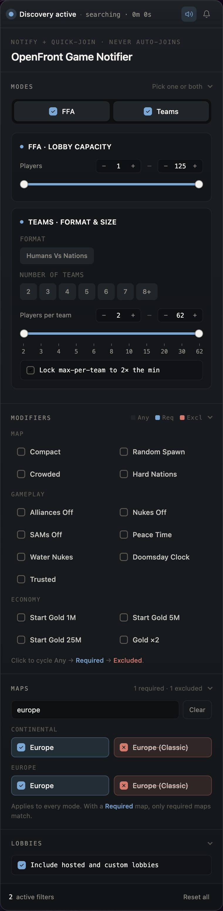

# OpenFront Game Notifier

A TypeScript userscript for OpenFront `v0.31+` that watches public lobbies and notifies you when one matches your filters — via in-page highlight, sound, and optional desktop notification. It shows every advertised lobby on a **Lobby Board** in place of the lobby area of the home page, and enhances OpenFront's native join modal. Never auto-joins.

## For Players



### Features

**Lobby discovery**
- Filter `FFA` and `Team` public lobbies by mode, format, team count, capacity, and modifiers
- Matching evaluates **every advertised lobby**: the live lobby, all upcoming lobbies of each queue (OpenFront's "See all" list), and hosted lobbies
- Global **map filter**: mark maps as required or excluded, with search and categories
- `Humans Vs Nations` matches only when its format is selected
- Hosted and custom lobbies are included by default; one option excludes them
- Team panel splits into `Format` (`Humans Vs Nations`) and `Number of teams` (`2`–`7`)
- Capacity sliders use the right semantics per mode: total lobby size for `FFA`, players-per-team for `Team`
- Per-team slider uses log-scaled stops with editable steppers; optional `2×` lock pins the max to twice the minimum
- Tri-state modifier filters cycle `Any` → `Required` → `Excluded`, grouped by `Map` / `Gameplay` / `Economy`

**Lobby Board**
- Shows every advertised lobby of every queue (`FFA`, `Team`, `Special`, `Hosted`) at once: one column per queue, one row per queue position
- Each card shows the map thumbnail on the left, then the map name, the team format and the active modifiers. A gauge along the card bottom shows the players
- A Live Lobby, and a Hosted Lobby with a start time, show a countdown on the thumbnail. A Custom Lobby has a small "Custom" tag
- A card that matches your filters is in full colour with a thin orange frame; the other cards are dimmed but stay readable when you point at them
- Clicking a card navigates to OpenFront's own join modal — manual quick-join only, you still confirm entry there

**Alerts**
- A lobby alerts once when it starts to match, at any queue position. It alerts again if it stops matching and then matches again
- A match that arrives while the OpenFront window has no focus gets a "New" badge on its card. The badge goes when the window loses focus again
- Optional sound alert on new matches
- Optional desktop notification when the OpenFront tab is in the background; clicking it brings the tab to the front and flashes the card on the board
- Sound on game start, triggered by OpenFront's own `?live` URL transition or its `in-game` page state (streamer mode)

**Smart UX**
- Stronger highlight for your own player row (and your team card) inside the native join modal
- Filter settings persist across reloads
- The filters live in a **sidebar** on the left of the Lobby Board, so nothing floats over the OpenFront page. The sidebar collapses to a thin rail that shows a short summary of your filters (for example `FFA · 2 modifiers · 1 map`), and it remembers whether it is collapsed across reloads
- The Lobby Board **header** holds the discovery switch with its status, the search timer, the sound toggle and the desktop notification toggle
- Every filter section (Modes, Modifiers, Maps, Lobbies) collapses, and the sidebar remembers which ones across reloads
- If the Lobby Board cannot show on the OpenFront page, the filters and the controls fall back to a floating panel
- The **Original page** switch, in the Lobby Board header, hides the Lobby Board and brings back OpenFront's own lobby area. The filters and the controls then move to a floating panel, and the same switch in its header brings the Lobby Board back. In this mode the notifier highlights matches on OpenFront's page: the queue cards and the "See all" button pulse, and the matching cards in the See All View get a highlight. A click on a desktop notification opens the See All View when the home page does not show the lobby. The alerts (sound and desktop notification) follow the same rules in both modes. The notifier remembers the mode across reloads, and the Lobby Board is the default
- Discovery feedback automatically pauses while you're already inside a joined lobby flow

### Modifier filters

- Compact
- Random Spawn
- Crowded
- Hard Nations
- Alliances Disabled
- Nukes Disabled
- SAMs Disabled
- Peace Time
- Water Nukes
- Doomsday Clock
- Trusted
- Starting Gold `1M`, `5M`, `25M`
- Gold Multiplier `x2`

### Requirements

- OpenFront `v0.31+`
- [Tampermonkey](https://www.tampermonkey.net/) or [Greasemonkey](https://www.greasespot.net/)
- Browser notification permission (only if you want desktop alerts)

### Install

1. Install Tampermonkey or Greasemonkey.
2. Install from Greasy Fork: [OpenFront Game Notifier][greasyfork].
3. Visit [openfront.io](https://openfront.io/).

### Usage

1. Open the Play page on [openfront.io](https://openfront.io/).
2. In the Lobby Board sidebar, enable `FFA`, `Team`, or both.
3. For `Team`, optionally toggle `Humans Vs Nations` and pick allowed team counts (`2`–`7`).
4. Set capacity bounds; click modifier chips to require or exclude them.
5. When a card on the Lobby Board gets a "New" badge, click it yourself to open OpenFront's join modal for that lobby.

### What this doesn't do

- Never auto-joins, auto-rejoins, or switches lobbies.
- Never modifies the native join modal — the player-row highlight is purely additive styling.
- Doesn't read or write any cross-domain data.

## For Developers

### Project structure

```text
.
├── src/
│   ├── config/                                 # constants, theme tokens
│   ├── data/
│   │   └── LobbyDataManager.ts                 # OpenFront's public-lobbies-update event
│   ├── modules/
│   │   └── lobby-discovery/
│   │       ├── CurrentPlayerHighlighter.ts     # additive native-modal enhancer
│   │       ├── LobbyDiscoveryEngine.ts         # criteria matching
│   │       ├── LobbyDiscoveryHelpers.ts        # pure helpers
│   │       ├── LobbyDiscoveryTypes.ts
│   │       ├── LobbyDiscoveryUI.ts             # panel UI
│   │       ├── RangeSlider.ts                  # per-team log-scaled slider component
│   │       └── RangeSliderHelpers.ts           # pure stop/position helpers
│   ├── styles/
│   ├── types/
│   ├── utils/
│   │   ├── BrowserNotificationUtils.ts
│   │   ├── LobbyUtils.ts
│   │   ├── SoundUtils.ts
│   │   └── URLObserver.ts
│   └── main.ts
├── tests/
├── dist/bundle.user.js
├── package.json
├── tsconfig.json
├── esbuild.config.js
└── vitest.config.js
```

### Quick start

Prerequisites: Node.js `18+` and npm.

```bash
npm install
npm run build:prod   # writes dist/bundle.user.js
```

Common scripts:

```bash
npm run dev          # esbuild watch
npm run build:prod   # production bundle
npm run test         # vitest --run (use --watch for TDD)
npm run type-check   # tsc --noEmit
```

### Storage keys

- `OF_LOBBY_DISCOVERY_SETTINGS` — criteria, map filter, sound/desktop preferences, hosted option, `2×` toggle

### Testing

Vitest with JSDOM. The suite covers the matching engine, helpers, panel UI, the native-modal highlighter, and the `LobbyDataManager` feed parsing.

```bash
npm run test
npm run test -- --watch
npm run test -- --coverage
```

### Contributing

- Follow the existing layered architecture (`config → types → styles → utils → data → modules → main`).
- Use `@/` path aliases.
- Keep new logic covered by tests; run `npm run test` and `npm run type-check` before shipping.
- Rebuild `dist/bundle.user.js` for releases (`npm run build:prod`).

### License

UNLICENSED — private project.

### Authors

DeLoVaN · SyntaxMenace · DeepSeek · Claude

[greasyfork]: https://greasyfork.org/en/scripts/555551-openfront-io-lobby-intel-discovery
